# newsiie

### A News Reader for the Apple IIe

#### User's Guide · Version 0.9

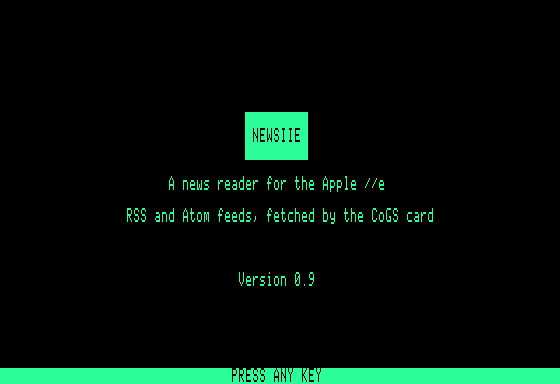

---

## Contents

- [About This Guide](#about-this-guide)
- [Chapter 1: Getting Started](#chapter-1-getting-started)
- [Chapter 2: Reading the News](#chapter-2-reading-the-news)
- [Chapter 3: Your List of Feeds](#chapter-3-your-list-of-feeds)
- [Chapter 4: Keeping What You Read](#chapter-4-keeping-what-you-read)
- [Appendix A: Quick Reference](#appendix-a-quick-reference)
- [Appendix B: Messages](#appendix-b-messages)
- [Appendix C: For the Technically Curious](#appendix-c-for-the-technically-curious)

---

## About This Guide

Welcome to newsiie. With newsiie and a CoGS card, your Apple IIe can
read the news from all over the world: the headlines from newspapers,
magazines, scientists and hobbyists, delivered straight to your
80-column screen.

This guide shows you how. You don't need to know anything about
computers or networks to use it. If you can put a disk in a drive and
press a key, you can read the news with newsiie.

**Chapter 1** tells you what you need and how to start newsiie.
**Chapter 2** takes you through reading a feed, from the list of
headlines to the story itself. **Chapter 3** shows how to add the feeds
you like and remove the ones you don't. **Chapter 4** explains how
newsiie remembers what you've read and how to save a story to disk. At
the back of the guide you'll find a one-page summary of the keys, a list
of the messages newsiie can show you, and some notes for people who want
to know how it all works.

### What Is a Feed?

Many newspapers, magazines and other publishers offer a **feed**: a list
of their latest stories, published on the Internet in a standard form
called RSS or Atom. Each story in a feed has a headline, a date, a short
summary, and the address of the full story.

newsiie fetches feeds and shows them to you. It reads the headlines and
summaries; it does not fetch the full stories, which are written for
modern computers.

### Conventions Used in This Guide

Keys you press are shown in capital letters: RETURN, ESC, SPACE BAR.
The arrow keys are called UP ARROW, DOWN ARROW, LEFT ARROW and RIGHT
ARROW.

When you see **OPEN-APPLE-Q**, hold down the OPEN-APPLE key (the key
with the outline of an apple, to the left of the space bar) and press Q.
Then let go of both keys.

> **Important:** Paragraphs like this one contain information you need
> to know to avoid a problem.

> **By the way:** Paragraphs like this one contain extra information
> that's interesting, but not essential.

---

## Chapter 1: Getting Started

### What You Need

To use newsiie, you need

- an **Apple IIe** with **128K** of memory and an **80-column text
  card**. (The enhanced Apple IIe is best: it shows newsiie's special
  symbols. An unenhanced Apple IIe works too, with plain letters in
  their place.)
- a **CoGS card** installed in any slot, and connected to your network.
- the **newsiie disk**: on a floppy disk, a hard disk, or the CoGS
  card's own network disk.

> **Important:** Set up the CoGS card's network connection before you
> start newsiie, using the card's own configuration screen. The CoGS
> card's manual tells you how. newsiie uses the connection; it doesn't
> set it up.

### Starting newsiie

1. Put the newsiie disk in the startup drive, or choose it on your CoGS
   card.
2. Turn on the computer, or press CONTROL-OPEN-APPLE-RESET if it's
   already on.

The title screen appears (you saw it on the cover of this guide). While
it's showing, newsiie finds your CoGS card and checks its connection.

3. Press any key to continue.

You'll see the **Feeds screen**: the list of feeds that newsiie can
fetch for you. newsiie comes with seven feeds already in the list, so
you can begin reading right away.

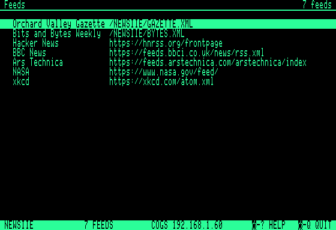

**Figure 1-1.** The Feeds screen

### The Status Bar

The bright bar along the bottom of the screen is the **status bar**. It
tells you where you are and what newsiie is doing. In Figure 1-1 it
shows that seven feeds are in your list, that the CoGS card is connected
(the numbers are its address on your network), and that you can press
OPEN-APPLE-? for help at any time.

When newsiie has something to tell you, its message takes over the
status bar until you press the next key.

> **By the way:** The pictures in this guide were made on an Apple IIe
> simulator without a CoGS card, so the address you see in them is just
> an example. Yours will be different.

### Getting Help

Whenever you need a reminder, press **OPEN-APPLE-?**. A box appears with
every key that newsiie understands. Press any key to make it go away.

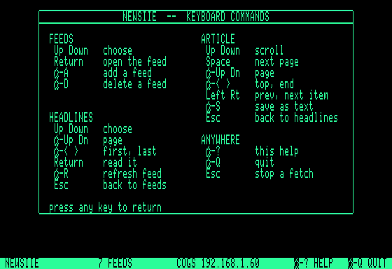

**Figure 1-2.** The help box

### Quitting

To stop using newsiie, press **OPEN-APPLE-Q**. newsiie saves what it
needs to and returns you to ProDOS.

---

## Chapter 2: Reading the News

### Choosing a Feed

1. On the Feeds screen, press UP ARROW or DOWN ARROW to move the bright
   bar to the feed you want.
2. Press RETURN.

newsiie fetches the feed. While it works, the status bar shows how much
has arrived: for example, `FETCHING 37K, 12 ITEMS`. A large feed can
take half a minute.

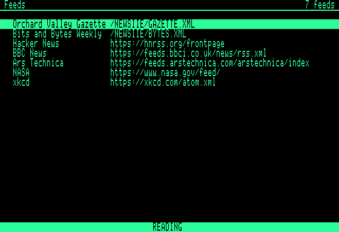

**Figure 2-1.** newsiie at work. This feed is on the disk, so the status
bar says `READING`; a feed from the Internet says `FETCHING`.

> **By the way:** If a feed is taking too long, press ESC. newsiie stops,
> and you can read whatever has arrived so far.

### The Headlines Screen

When the feed has arrived, you'll see its **Headlines screen**: one
story to a line, newest first, with the date and time of each. The
status bar tells you how many stories arrived and how long they took.

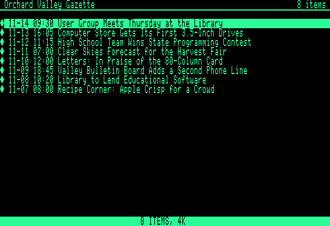

**Figure 2-2.** The Headlines screen

A small diamond at the left marks each story you haven't read yet.

To move through the headlines:

- Press UP ARROW or DOWN ARROW to move the bar one story at a time.
- Hold down OPEN-APPLE and press UP ARROW or DOWN ARROW to move a whole
  screen at a time.
- Press OPEN-APPLE-< to go to the first story, or OPEN-APPLE-> to go to
  the last.

To fetch the feed again and see whether anything new has arrived, press
**OPEN-APPLE-R**.

### Reading a Story

1. Move the bar to the story you want to read.
2. Press RETURN.

The **Article screen** shows the story's headline, date and address, and
under the line, its summary.

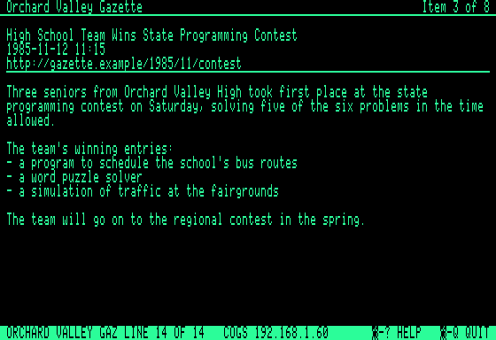

**Figure 2-3.** The Article screen

- Press DOWN ARROW and UP ARROW to scroll a line at a time.
- Press the SPACE BAR, or OPEN-APPLE with an arrow, to scroll a screen at
  a time.
- Press RIGHT ARROW to read the next story, or LEFT ARROW for the one
  before. You don't need to go back to the headlines in between.
- Press ESC when you're finished. You return to the Headlines screen,
  with the bar on the story you were reading.

Notice that the diamond is gone from each story you've read.

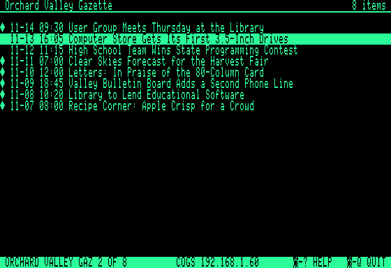

**Figure 2-4.** After reading two stories, only the first still has its
diamond.

When you're done with a feed, press **ESC** to return to the Feeds
screen and choose another.

---

## Chapter 3: Your List of Feeds

You can add up to 21 feeds to your list, and remove any you no longer
want. newsiie saves your list on the disk as soon as you change it.

### Adding a Feed

To add a feed, you need its address. Most websites that offer a feed
show its address on the site; look for the words "RSS," "Atom" or
"feed."

1. On the Feeds screen, press **OPEN-APPLE-A**.

   newsiie asks for the feed's address on the status bar.

2. Type the address.

   You can leave off the `https://` at the beginning; newsiie adds it for
   you. If you make a mistake, press DELETE or LEFT ARROW to erase it.

   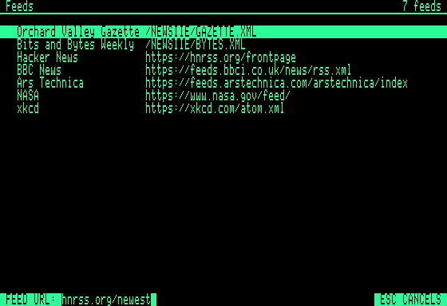

   **Figure 3-1.** Typing a feed's address

3. Press RETURN.

   newsiie suggests a name for the feed, taken from its address.

   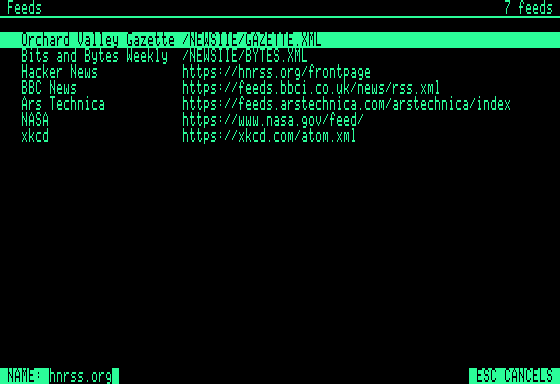

   **Figure 3-2.** Naming the feed

4. Press RETURN to accept the name, or erase it and type a name of your
   own, then press RETURN.

The new feed appears at the end of your list.

> **By the way:** You can press ESC at any time to cancel, and nothing
> is added.

### Removing a Feed

1. Move the bar to the feed you want to remove.
2. Press **OPEN-APPLE-D**.

   newsiie asks whether you're sure.

   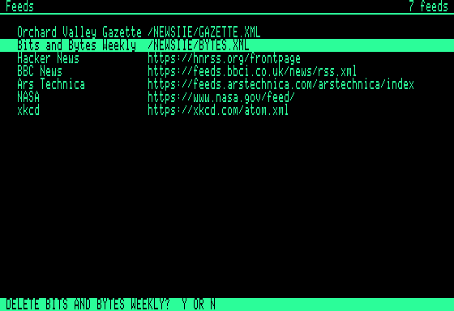

   **Figure 3-3.** Removing a feed

3. Press **Y** to remove it, or any other key to keep it.

### Editing the List Yourself

Your list is kept in a text file named `NEWSIIE.FEEDS`, on the same disk
as newsiie. You can change it with any text editor, such as ZipEdit. Each
line holds one feed: its name, a bar ( | ), and its address.

```
Orchard Valley Gazette|/NEWSIIE/GAZETTE.XML
Hacker News|https://hnrss.org/frontpage
https://xkcd.com/atom.xml
```

A line with only an address is named after its website. A line that
begins with # is a note for you; newsiie skips it.

> **By the way:** As the first line shows, a feed doesn't have to come
> from the Internet. If you have a feed saved as a file, give its ProDOS
> pathname, beginning with a slash, and newsiie reads it from the disk.

> **Important:** When newsiie saves your list, it writes it out fresh,
> so any notes beginning with # are not kept.

---

## Chapter 4: Keeping What You Read

### Stories You've Read

newsiie remembers the last 256 stories you've read, even after you turn
the computer off. The next time you fetch a feed, the stories you've
already read arrive without their diamonds, so you can see at a glance
what's new.

newsiie keeps this record in a file named `NEWSIIE.READ`. It saves the
file when you leave a feed's headlines and when you quit.

### Saving a Story

You can save any story to the disk, to read again later or to use in
your own writing.

1. While you're reading the story, press **OPEN-APPLE-S**.

   newsiie suggests a filename made from the headline.

   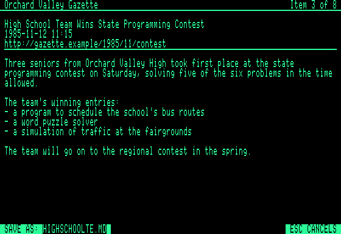

   **Figure 4-1.** Saving a story

2. Press RETURN to use the suggested name, or erase it and type your
   own.

   A ProDOS filename can have up to 15 letters, numbers and periods, and
   must begin with a letter. To save on a different disk or in a
   different folder, type a full pathname such as `/MYDISK/NOTES/FAIR.MD`.

newsiie tells you on the status bar when the story is saved. If a file
with that name is already there, newsiie asks before replacing it.

The saved story is a text file. It begins with the headline, the date and
the story's address, followed by the summary. You can open it in ZipEdit
or any other text editor.

> **By the way:** The file is written in a simple style called Markdown,
> in which a line beginning with # is a heading. ZipEdit is a Markdown
> editor, so saved stories look right at home there.

### If the Disk Can't Be Changed

If the newsiie disk is write-protected, newsiie can't save your feed list,
your read stories, or your saved stories there. It tells you once, then
carries on: your list works as usual until you quit.

> **Important:** If you start newsiie from the CoGS card's network disk,
> whether you can save depends on where the disk image is kept. The CoGS
> Image Manager's shared folder accepts changes; many other places don't.

---

## Appendix A: Quick Reference

### Everywhere

| Press | To |
|---|---|
| OPEN-APPLE-? | see the list of keys |
| OPEN-APPLE-Q | quit newsiie |
| ESC | stop fetching a feed |

### On the Feeds Screen

| Press | To |
|---|---|
| UP ARROW, DOWN ARROW | choose a feed |
| RETURN | fetch it and see its headlines |
| OPEN-APPLE-A | add a feed |
| OPEN-APPLE-D | remove the chosen feed |

### On the Headlines Screen

| Press | To |
|---|---|
| UP ARROW, DOWN ARROW | choose a story |
| OPEN-APPLE-UP ARROW, OPEN-APPLE-DOWN ARROW | move a screen at a time |
| OPEN-APPLE-<, OPEN-APPLE-> | go to the first or last story |
| RETURN | read the chosen story |
| OPEN-APPLE-R | fetch the feed again |
| ESC | return to the Feeds screen |

### On the Article Screen

| Press | To |
|---|---|
| UP ARROW, DOWN ARROW | scroll a line |
| SPACE BAR, OPEN-APPLE-UP ARROW, OPEN-APPLE-DOWN ARROW | scroll a screen |
| OPEN-APPLE-<, OPEN-APPLE-> | go to the top or the end |
| LEFT ARROW, RIGHT ARROW | read the story before or after |
| OPEN-APPLE-S | save the story to the disk |
| ESC | return to the Headlines screen |

### When newsiie Asks a Question

| Press | To |
|---|---|
| RETURN | accept what you've typed |
| DELETE, LEFT ARROW | erase the last letter |
| ESC | cancel |

---

## Appendix B: Messages

These are the messages newsiie may show on the status bar, what they
mean, and what to do.

**NO COGS CARD**
newsiie couldn't find a CoGS card. Make sure the card is firmly seated
in its slot, then start newsiie again.

**WAITING FOR THE NETWORK**
The CoGS card isn't connected to your network yet. This is normal for a
few seconds after you turn the computer on; newsiie waits up to 20
seconds. If it never connects, check the card's configuration screen.

**WAITING FOR THE CARD'S CLOCK (HTTPS NEEDS IT)**
Feeds whose addresses begin with `https` are protected, and the CoGS
card must know the date and time to open them. The card sets its clock
from the Internet a few seconds after it connects. newsiie waits up to
20 seconds.

**DNS FAILED**
The card couldn't find the website named in the feed's address. Check
the address for a typing mistake.

**NO NETWORK**
newsiie waited 20 seconds and the CoGS card still wasn't connected.
Check the card's configuration screen.

**THE CARD'S CLOCK IS NOT SET, AND HTTPS NEEDS IT**
newsiie waited 20 seconds and the card still didn't know the time. Try
again in a minute; if it keeps happening, check the card's clock settings.

**TIMED OUT**
The website didn't answer. It may be busy or out of service; try again
later.

**THE SERVER REFUSED IT (OR NOT FOUND)**
The website answered, but not with the feed. The feed may have moved.

**THAT IS NOT A FEED**
The address is for an ordinary web page, not a feed. Look on the website
for its feed's address.

**THE FEED HAS NO ITEMS**
The feed arrived, but had no stories in it.

**STOPPED**
You pressed ESC while a feed was arriving. Whatever arrived can still be
read.

**STOPPING WHEN THE SERVER ANSWERS**
You pressed ESC while newsiie was waiting for a website. It stops as
soon as the website replies.

**"memory full" in the heading**
The feed was larger than newsiie can hold at once. You can read the
stories that arrived first.

**THE DISK IS WRITE-PROTECTED**
newsiie couldn't save to the disk. See "If the Disk Can't Be Changed" in
Chapter 4.

**CANNOT OPEN THAT FILE**
A feed in your list is a ProDOS pathname, and that file isn't there.

---

## Appendix C: For the Technically Curious

### How newsiie Uses Your Apple

newsiie is written in C and 6502 assembly language. The CoGS card does
the hard work of the Internet: it finds websites, makes secure
connections, and holds each feed while newsiie reads it at its own pace,
512 characters at a time. newsiie sorts the feed into stories as it
arrives, so it never needs to keep the whole feed in memory.

The stories are stored in the Apple IIe's auxiliary memory, the second
64K of your 128K. ProDOS normally keeps a small disk, `/RAM`, in that
memory; newsiie turns `/RAM` off when it starts, and ProDOS turns it back
on the next time you start up. Anything you had saved on `/RAM` is
cleared.

### Starting from the CoGS Network Disk

newsiie works well when you start it from the CoGS card's network disk.
The card carries both the disk and the feeds, so newsiie takes care
never to use the disk while a feed is arriving.

### Two Programs for Checking Your Card

The newsiie disk also has two programs for checking the CoGS card. To use
them, quit newsiie and choose one from the ProDOS menu.

- **PROBE.SYSTEM** checks the card from one end to the other: its slot,
  its version, its network connection, its clock, and the data it sends
  and receives.
- **FETCH.SYSTEM** fetches six sample feeds from the Internet and reports
  how long each took and what it contained.

### The Files newsiie Keeps

| File | Contains |
|---|---|
| `NEWSIIE.FEEDS` | your list of feeds, as text |
| `NEWSIIE.READ` | the stories you've read |

---

*newsiie is an independent project. It is not affiliated with, authorized
by, or endorsed by Apple Inc. Apple and Apple IIe are trademarks of
Apple Inc. The feeds shown in this guide's pictures are made up for the
purpose; every place, person and event in them is fictional.*
